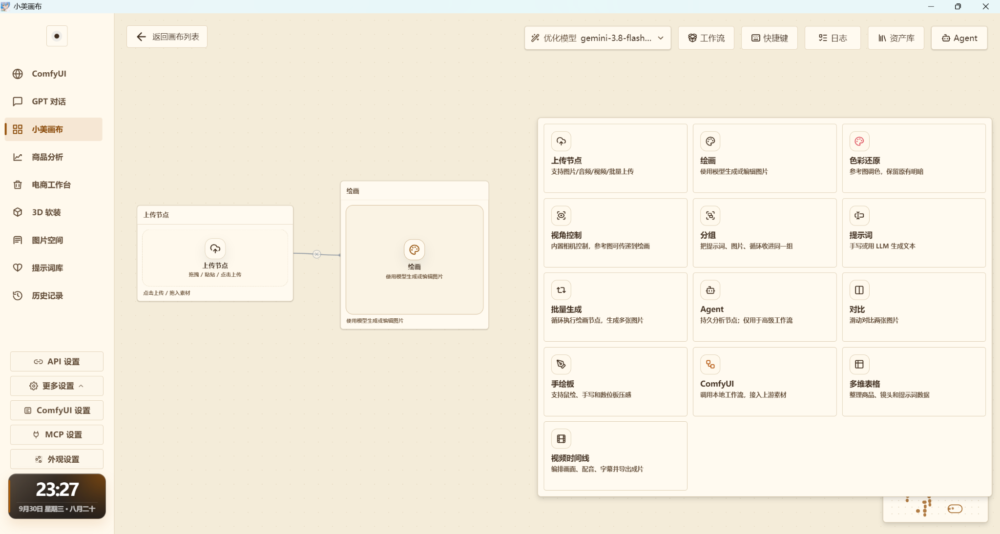

# 小美画布（Xiaomei Canvas）

**小美画布（Xiaomei Canvas）** 是一款面向 AI 图像、视频、提示词整理与工作流编排的无限画布工具。

本项目基于 [Infinite-Canvas](https://github.com/hero8152/Infinite-Canvas) 进行二次开发，在原项目基础上对界面、功能及部分交互进行了修改和扩展。

> 当前项目仍在持续开发中，部分功能可能还会继续调整或完善。

---

## 软件界面



上图为小美画布当前主界面。  
软件以可视化画布为核心，支持在画布中组合节点、整理素材、调用模型与工作流，并尽量将常用 AI 功能集中到统一界面中。

---

## 项目介绍

小美画布希望把 AI 相关的常用能力整合到一个自由画布中，方便用户在一个界面里完成：

- 图片生成与编辑
- 视频处理与控制
- 提示词整理
- 多模型调用
- ComfyUI 工作流接入
- 素材管理
- 节点组合与流程编排

相比传统单一功能工具，小美画布更强调“在一个画布内完成多步骤工作流”的使用体验。

---

## 主要功能

### 1. 无限画布

以无限画布为核心工作区，可自由摆放不同节点，并通过连接关系组织工作流程。

### 2. 节点式工作流

支持通过节点来完成不同任务的组合，例如上传素材、绘图、提示词生成、分组、对比、批量生成等。

### 3. AI 图像相关功能

支持图像生成、参考图处理、色彩还原、手绘板辅助等功能，适合图片创作与素材整理场景。

### 4. 视频相关功能

支持视频控制、视频时间线等相关功能，可用于视频片段处理与工作流扩展。

### 5. ComfyUI 接入

支持接入 ComfyUI 工作流，便于将本地或局域网中的工作流能力整合到画布中统一调用。

### 6. 提示词与素材管理

支持提示词整理、图片分组、素材归档与对比查看，提高多图、多步骤创作时的整理效率。

### 7. 多种工作场景

小美画布目前提供了多个功能入口，例如：

- ComfyUI
- GPT 对话
- 小美画布
- 商品分析
- 电商工作台
- 3D 软装
- 图片空间
- 提示词库
- 历史记录

后续会根据开发进度继续完善。

---

## 使用场景

小美画布适合以下类型的使用需求：

- AI 生图与改图
- 多张图片素材整理
- 提示词管理与复用
- ComfyUI 工作流调用
- 电商图像处理辅助
- 图片对比与批量生成
- 视频创作辅助
- 多步骤创作流程编排

---

## 下载与使用

普通用户可从 [GitHub Releases 最新版本](https://github.com/jkjk-8614/xiaomei/releases/latest) 下载对应平台的安装包。需要修改功能或参与开发，可从[仓库主页](https://github.com/jkjk-8614/xiaomei)获取源码。

Windows 基础安装包使用 CPU 版 ONNX Runtime。需要 NVIDIA 加速时，可在安装目录运行 `tools/install-windows-gpu-runtime.ps1` 单独下载 GPU 组件。

---

## 开发说明

本项目目前为持续开发中的二次开发项目。

如需自行研究或修改，可先克隆仓库：

```bash
git clone https://github.com/jkjk-8614/xiaomei.git
```

后续运行方式、依赖安装方法及发布说明会继续补充。

---

## 项目来源与致谢

**小美画布（Xiaomei Canvas）** 是基于 [Infinite-Canvas](https://github.com/hero8152/Infinite-Canvas) 进行二次开发，并参考 [CainFlow](https://github.com/RingoCaviar/CainFlow) 项目设计与实现思路的项目。

### 原项目一：Infinite-Canvas

- **项目名称：** Infinite-Canvas
- **原作者：** [hero8152](https://github.com/hero8152)
- **项目地址：** https://github.com/hero8152/Infinite-Canvas

感谢原作者开发并公开 Infinite-Canvas，为本项目提供了基础框架。

### 参考项目二：CainFlow

- **项目名称：** CainFlow
- **原作者：** [RingoCaviar](https://github.com/RingoCaviar)
- **项目地址：** https://github.com/RingoCaviar/CainFlow

感谢原作者开发并开源 CainFlow，为节点式工作流设计与交互实现提供了参考。

### 二次开发说明

小美画布在原项目基础上，对界面、功能及部分交互进行了修改与扩展，并结合其他优秀项目的设计思路持续完善。

本项目为非官方二次开发版本，与上述项目原作者不存在官方从属关系。

原项目代码及相关版权归各自权利人所有，具体使用、修改与分发应遵守相应项目的许可证要求。

---

## 开源与使用说明

本项目基于 Infinite-Canvas 进行二次开发，并遵循原项目的许可要求。

根据原项目 LICENSE：

- 本项目必须保持开源；
- 必须注明原项目及原作者；
- 可以用于个人使用和公司内部使用；
- 禁止将本项目修改、封装后作为商业产品；
- 商业使用需要获得原作者授权。

原项目许可证地址：

https://github.com/hero8152/Infinite-Canvas/blob/main/LICENSE

本仓库保留相应 LICENSE 文件，请在使用、修改或分发本项目之前仔细阅读许可说明。

---

## 免责声明

本项目主要用于个人学习、研究、工作流探索与效率辅助。

项目中调用的第三方模型、API、服务或平台，均由其各自提供方负责。  
使用者在使用相关功能时，应自行遵守对应服务条款及当地法律法规。

因使用本项目或第三方服务产生的数据、费用、账号风险或其他问题，由使用者自行承担。

---

## 项目状态

小美画布目前仍处于持续开发与调整阶段。

后续计划包括但不限于：

- 完善画布交互体验
- 持续优化节点系统
- 增强图片 / 视频相关能力
- 丰富工作流接入方式
- 改进设置与管理功能
- 完善文档与发布版本

如果你有功能建议或发现 Bug，欢迎通过 [GitHub Issues](https://github.com/jkjk-8614/xiaomei/issues) 反馈。

---

## 问题反馈与交流群

如果在使用小美画布时遇到问题、发现 Bug，或者有功能建议，欢迎加入微信交流群反馈。

也欢迎大家在群里交流 AI 生图、视频创作、电商设计以及软件使用经验。

**微信交流群：AI电商-小美画布**


> 微信群邀请二维码已于 **2026 年 10 月 30 日** 更新，有效期至 **2026 年 11 月 6 日前**。如二维码失效，请通过 [GitHub Issues](https://github.com/jkjk-8614/xiaomei/issues) 反馈。
